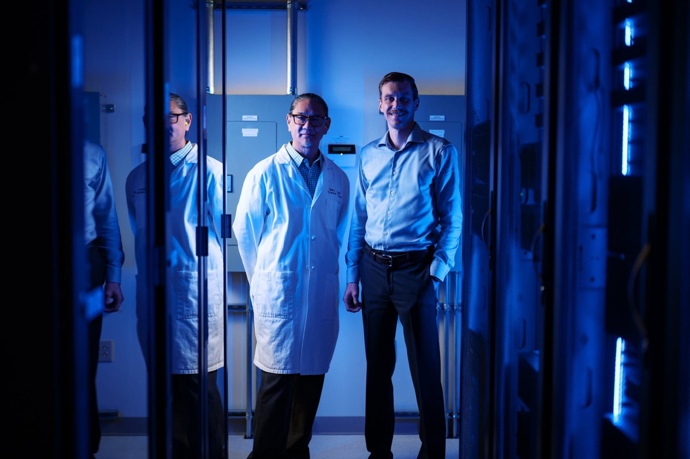

<h5>ReSCUED (Reprogramming Severe Critical Illness Using Extensible Digital Twins) is a multi-site, milestone-based effort of up to five years, funded by the Advanced Research Projects Agency for Health (ARPA-H) through its <a href="https://arpa-h.gov/explore-funding/programs/circle">Critical Illness Immunological Reprogramming and Control Point Learning Engine (CIRCLE)</a> program. The project, led by <a href="{{ '/people.html#gary-an' | relative_url }}">Dr. Gary An</a> as Principal Investigator, aims to build AI-powered digital twins of critically ill patients that clinicians can use to understand and correct the disordered immune response driving diseases of the ICU, such as sepsis, severe trauma and burns.</h5>

### The problem

Modern organ support lets us keep critically ill patients alive far longer than was once possible, but many of these patients remain trapped in a state of immune dysfunction that we do not know how to reverse. The dynamics of that dysfunction are high-dimensional and change over hours; they exceed what any individual clinician can integrate at the bedside. Roughly 4.6 million Americans are treated in ICUs each year, at a cost of up to $70 billion.

### Our approach: measure, model, modulate

- **Measure.** Each enrolled patient's immune and inflammatory state is sampled frequently (blood drawn every six hours, along with physiological monitoring), quantifying the key cells, proteins and molecular mediators present.
- **Model.** These data are used to instantiate and continuously update a mechanism-based digital twin of that individual patient, so that its forecast of the patient's trajectory is refined as their condition evolves.
- **Modulate.** The digital twin serves as the training environment for an AI "virtual consultant" that searches for intervention strategies using FDA-approved agents, and tests them on the twin before any treatment reaches the patient.

The goal is a clinician-facing tool that shows how a patient's illness is evolving and helps select the right treatment at the right time. If successful, the program target is a reduction in ICU length of stay of at least 25 percent, and the same framework could extend to other diseases in which patients respond differently to the same therapy.

### Our role

The An-Cockrell Lab at the UVM Larner College of Medicine is the lead institution and is responsible for the computational models and the digital twin platform. This work builds directly on the lab's prior development of the Critical Illness Digital Twin concept (see <a href="https://doi.org/10.48550/arXiv.2405.05301">An &amp; Cockrell, 2024</a>) and of simulation-based deep reinforcement learning for multimodal control of systemic inflammation.

### Partners

- **Clinical sites:** Wake Forest University School of Medicine and the University of Alabama at Birmingham Heersink School of Medicine (through the <a href="https://www.quantumleaphealth.org">Quantum Leap Healthcare Collaborative</a>), and Washington University School of Medicine in St. Louis
- **Technology partners:** <a href="https://www.dnamedinstitute.com">DNA Medicine Institute</a> (bedside molecular testing) and <a href="https://inflammasense.com">InflammaSense</a> (wearable monitoring of vagus nerve activity)

### Timeline

The first three years focus on developing and validating the digital twin and demonstrating that it can predict patient outcomes computationally. Contingent on those milestones, later phases test the technology in additional experimental settings before moving to clinical trials in critically ill patients.

### Learn more

- <a href="https://www.uvm.edu/uvmnews/news/your-ai-twin-could-save-your-life-uvm-awarded-38m-build-digital-twins-treating">UVM News announcement (September 30, 2026)</a>
- <a href="https://arpa-h.gov/explore-funding/awards/4718">ARPA-H award page</a>
- <a href="https://arpa-h.gov/explore-funding/programs/circle">ARPA-H CIRCLE program</a>

<em>This research is funded in part by the Advanced Research Projects Agency for Health (ARPA-H). The views and conclusions expressed here are those of the authors and do not necessarily represent the official policies, express or implied, of the U.S. Government.</em>

